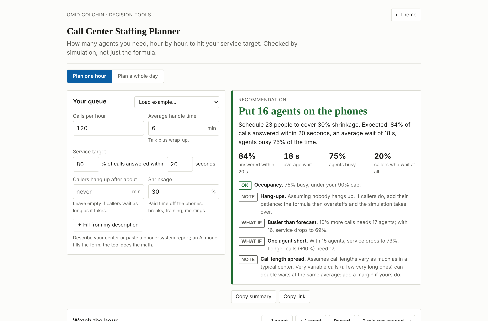

# Call Center Staffing Planner

For anyone who runs a phone line (a support desk, a clinic, a help line): enter your calls per hour and call length, get how many agents to put on the phones and how many people to schedule to hit your service target, for one hour or a whole day.




**Use it:** https://omidgolchin.github.io/queue-simulator/ (runs in your browser; nothing you type leaves it)

## What it does

- **Plan one hour.** Calls per hour, average handle time and your service target (for example 80% answered within 20 seconds) give the agents to put on the phones, the people to schedule after shrinkage, and the expected service level, average wait and how busy agents will be.
- **Plan a whole day.** Calls per day and the shape of the day (a typical weekday, flat, or your own hourly counts) give agents hour by hour, total agent-hours and paid hours, cost, and a CSV to take into a scheduling tool.
- **Watch the hour.** The recommended staffing runs live, one second per minute; remove an agent and watch the queue build.
- **Fill from my description.** Describe your center in plain words or paste an interval report from your phone system; a language model (your key, or copy the prompt into any assistant) fills the form, quoting the phrase each number came from. The model never computes the answer.
- **Copy summary / Copy link / Download CSV.**

## Built-in checks

| Check | What it does |
|---|---|
| Occupancy cap | Never recommends agents busier than the cap (default 90%): meeting the target with agents at 95% is not a schedulable plan. The verdict says when the cap, not the target, set the number. |
| Callers who hang up | Erlang C assumes nobody hangs up and overstates waits when they do. With a patience set, the recommendation comes from simulation, and hung-up calls count as missed. |
| Shrinkage | Converts agents on the phones into people to schedule. |
| Busier than forecast | What 10% more calls or 10% longer calls would need, and what service drops to if they arrive. |
| One agent short | The service level with one fewer agent: how much margin the plan has. |
| Hour by hour (day plan) | Shows what staffing the whole day for its average hour would do to the peak. |

## Design decisions

- **Erlang C per hour, then a staffing search.** The standard workforce-management method (Gans, Koole & Mandelbaum 2003): the fewest agents whose service level meets the target, interval by interval.
- **Occupancy cap after the service search.** The target and the cap are separate constraints; the recommendation is the larger of the two answers, and the page says which one bound.
- **Simulation only where the formula fails.** With callers who hang up, the planner simulates the queue (20 independent 8-hour runs after a 1-hour warm-up, the same random numbers for every agent count so the curve is smooth). The browser engine agrees with this repository's SimPy simulator within confidence intervals on abandonment, waits and occupancy (tested).
- **Hung-up calls count against the service level.** The conservative convention: a caller who gave up was not served within the target.
- **The day plan uses Erlang C.** It ignores hang-ups, which makes it slightly generous; a busy hour can be checked by simulation in the one-hour view.
- **What-ifs use the same engine as the recommendation** (simulation when callers hang up, Erlang C otherwise), so the margins are comparable.

## Validation

- **36 tests** (`make test`): Erlang C against the raw-sum formula; the staffing search, occupancy cap, shrinkage and day plan in Python; the JavaScript against the Python on four staffing cases and a day plan; the browser simulation against SimPy on two settings with hang-ups; the browser simulation against Erlang C without hang-ups; the live animation against the simulation on average; the AI assist's prompt and reply handling.
- **The simulator behind it** reproduces Erlang C in 12 of 12 settings (inside the 95% interval) and Little's law within 0.12% ([results/summary.md](results/summary.md)).
- **AI assist extraction:** a 20-item test set (`assist/testset.json`: descriptions, interval reports, seconds vs minutes, shrinkage given as parts, cost per day instead of per hour, text with no numbers). Score any model with `ANTHROPIC_API_KEY=... node scripts/eval_assist.js`. Not yet run for this release.
- Checked on desktop and phone widths, in light and dark themes.

## What I learned

- The spread of call lengths matters as much as the average. At the
  same average call length, very variable calls (CV 2) more than
  doubled the wait. I now distrust any staffing table that quotes
  only averages.
- My first hand-simulation test instances were useless: drawn from an
  empty system, most had nobody waiting at all, so they tested no
  state tracking. The instance rule had to change (take a busy
  20-customer window from a longer stream) before the plan could
  freeze.
- For the overloaded center I nearly scored models against a
  finite-day average wait. There is no steady state there, so the
  only right answer is to say so, and the check now scores exactly
  that.
- The standard bank call-center dataset is registration-gated, so I
  used NYC 311 counts for the shape of a day instead. Only the shape
  is borrowed, and the write-up has to keep saying so.

- Planning one hour well is not enough: the planner needed a day view because the rush hour is where averages fail.

## Research notes

The studies behind the tool, kept out of it on purpose. Full numbers in [results/summary.md](results/summary.md).

- **Validation.** Across 12 M/M/c settings the formula falls inside the simulation's 95% interval in 12 of 12; Little's law holds within 0.12%. 
- **Where the formula breaks.** Very variable call lengths (lognormal, CV 2) doubled the average wait at the same mean (2.05 vs 1.07 min). With impatient callers at 95% utilization, 14.7% hang up and the served callers' wait collapses from 26 min to 1.3 min.
- **Rush hours.** On a day shaped like NYC 311 demand, staffing for the average hour left 41.4% of callers waiting over 20 seconds in the rush.
- **Can a language model do queueing math?** 15 scenarios, three open models, three ways. Asked directly, all three were close on 9 of 15, weak where the formula breaks. Asked to write code, one model was close on 14 of 15. Asked to simulate 20 customers by hand, they tracked about half before drifting. A small check, not a ranking.

## Run it

```bash
python3 -m venv .venv && .venv/bin/pip install -r requirements.txt
make test        # all tests, including the JavaScript engine
cd docs && python3 -m http.server 8000   # the tool at http://localhost:8000
make validate    # the simulation studies (cached; slow the first time)
make reproduce   # results/summary.md, figures and docs/data from outputs/
```

## Layout

- `docs/`: the tool (plain HTML and JavaScript, no build step). `staffing.js` holds the staffing search, the hang-up simulation and the live queue; `qsim.js` Erlang C and the event checker; `tool-common.js` and `tool.css` the shared tool kit; `assist-config.js` the AI assist's prompt; `nyc-shape.js` the weekday shape.
- `src/queuesim/`: `staffing.py` (reference for the planner), `erlang.py`, `simulate.py` (SimPy), and the research-notes studies and LLM check.
- `assist/` and `scripts/eval_assist.js`: the assist's test set and scorer.
- `PLAN.md`, `FREEZE_MANIFEST.txt`, `DECISIONS.md`, `SPEND.md`: the frozen plan, its hashes, every judgment call and the costs of the research experiments.

## Limitations

- One queue, identical agents, no skills-based routing.
- Calls are assumed to vary in length like a typical center (exponential). Steadier calls need fewer agents and very variable calls need more; the research notes show by how much.
- The weekday shape is borrowed from NYC 311 requests, which are not calls to one center: it is a realistic shape, not a forecast. Use your own counts for planning.

## References

1. Law, A. M. *Simulation Modeling and Analysis*, 6th edition,
   McGraw-Hill Education, 2024. ISBN 9781264268245.
   https://www.mheducation.com/highered/product/simulation-modeling-analysis-law.html
2. Hillier, F. S., Lieberman, G. J., Nag, B., Basu, P.
   *Introduction to Operations Research*, 12th edition, McGraw Hill,
   2024. Chapter 17 (Queueing Theory).
   https://www.mheducation.com/highered/product/introduction-operations-research-hillier.html
3. Little, J. D. C. (1961). "A Proof for the Queuing Formula:
   L = λW." *Operations Research* 9(3), 383–387.
   https://doi.org/10.1287/opre.9.3.383
4. SimPy documentation, version 4.1.2. https://simpy.readthedocs.io/en/latest/
5. Gans, N., Koole, G., & Mandelbaum, A. (2003). Telephone call centers: Tutorial, review, and research prospects. *Manufacturing & Service Operations Management*, 5(2), 79–141.
6. Garnett, O., Mandelbaum, A., & Reiman, M. (2002). Designing a call center with impatient customers. *Manufacturing & Service Operations Management*, 4(3), 208–227.
7. NYC Open Data, "311 Service Requests from 2010 to Present".
   https://data.cityofnewyork.us/Social-Services/311-Service-Requests-from-2010-to-Present/erm2-nwe9

## Citation and license

Omid Golchin. *Call Center Staffing Planner* (repository queue-simulator), 2026. See `CITATION.cff`.
Code: MIT License (`LICENSE`). The aggregated NYC 311 hourly counts
in `data/` are public open data; see `DATA_SOURCES.md`.
