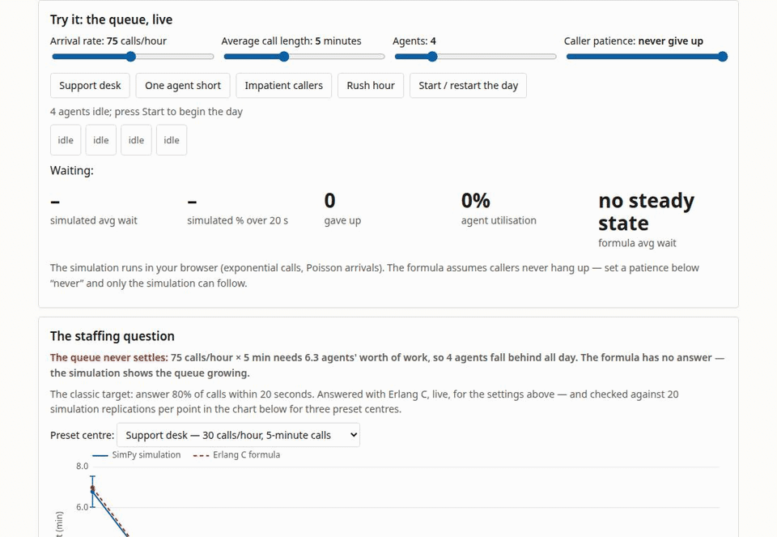
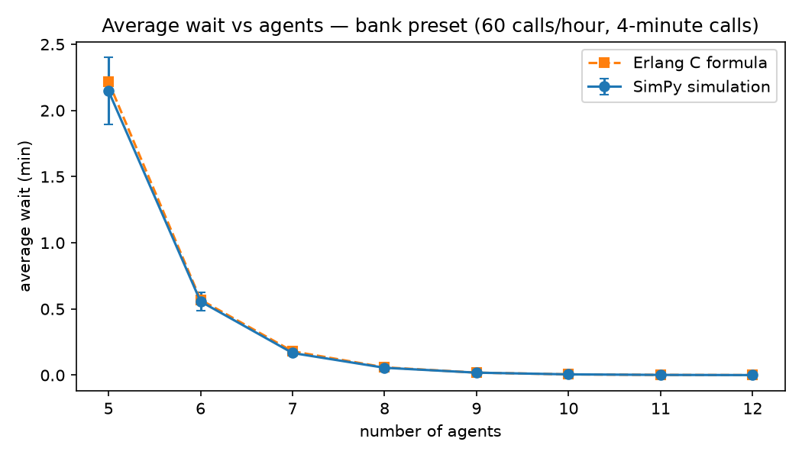

# Queue simulator: how many staff does a queue need?

A discrete-event queue simulator (SimPy) with the Erlang C staffing
formulas built in, made to answer one question: how many staff does a
queue need? Its sharpest result: staffing for the *average* hour of a
real-shaped service day leaves 41.4% of rush-hour callers waiting over
20 seconds.

I built this to learn discrete-event simulation properly: build the
simulator, check it against the queueing formulas it should reproduce,
use it where the formulas stop working, and then check whether an LLM
can do the same jobs. The setting throughout is a call centre, a bank,
a clinic desk: callers arrive at random, each call takes a random
time, and a small team answers.



## The result

The SimPy simulator reproduces Erlang C: across 12 M/M/c settings
(1–10 servers, utilisation 0.5–0.95, 16 replications each) the
formula's value falls inside the simulation's 95% confidence interval
in 12 of 12 settings, and Little's law holds within 0.12% in the runs'
own counters. Where the formula's assumptions break, it misleads in
specific ways: with very variable (lognormal, CV 2) call lengths the
true average wait is 2.05 min where Erlang C says 1.07; with impatient
callers at ρ = 0.95 the served callers' wait falls to 1.3 min because
14.7% of callers hang up, an effect the formula cannot see (with no
abandonment the simulation gives 26.9 min and the formula 26.3 min);
and on a day shaped like real arrival data (NYC 311), staffing for
the *average* hour leaves 41.4% of callers waiting over 20 seconds in
the rush, with day-average waits ten times the formula's prediction. The
LLM check (15 scenarios × 3 modes × 3 models): asked directly, all
three models were close on 9 of 15 scenarios — fine where the formula
applies, weak where it breaks (1–2 of the 5 beyond-formula cases);
asked to write code instead, one model's programs were close on 14 of
15 while the other two usually got one of the two requested numbers
right; asked to simulate 20 customers by hand, the models tracked
45–58% of customers to within a few seconds before drifting or
stopping early; and five of six runs correctly said the overloaded
centre has no steady state at all.



## Playground

The playground is in [`docs/`](docs/index.html) (open it with any
static server, e.g. `python3 -m http.server` inside `docs/`). Sliders
set the arrival rate, call length, agents and caller patience; a small
JavaScript twin of the simulator runs the queue live while Erlang C
answers the staffing question beside it: "how many agents to answer
80% of calls within 20 seconds?" The wait-vs-servers chart is
precomputed from the Python simulator (20 replications per point),
and the page shows how the LLMs did. The JavaScript and
Python implementations are checked against each other on fixed cases
(`scripts/check_js.py`); screenshots are in `docs/screenshots/`.

## Use the code

```bash
python3 -m venv .venv && .venv/bin/pip install -r requirements.txt

PYTHONPATH=src .venv/bin/python - <<'EOF'
from queuesim.erlang import mmc, servers_needed
r = mmc(lam=30/60, mu=1/5.0, c=4)      # 30 calls/hour, 5-minute calls
print(r.mean_wait_q)                   # 1.07 minutes
print(servers_needed(30/60, 1/5.0, 20/60))   # 5 agents for 80% in 20 s

from queuesim.simulate import QueueConfig, run_replications
cfg = QueueConfig(servers=4, service_mean=5.0, arrival_rate=30/60,
                  patience_mean=10.0, warmup=600, duration=6600)
print(run_replications(cfg, 20)["summary"]["mean_wait_q"])
EOF
```

Regenerate every number and figure from the saved outputs:

```bash
make validate    # the simulation studies (cached; slow the first time)
make reproduce   # results/summary.md + figures + docs/data from outputs/
make test        # the test suite
```

## How it was done

- **Simulator**: SimPy, one queue, c servers; Poisson or hourly
  time-varying arrivals; exponential/lognormal/uniform service;
  exponential patience; two-class non-preemptive priority. Statistics
  from independent replications with warm-up and t intervals, because
  one long run hides its own error (Law, ch. 9).
- **Validation**: Erlang C and Little's law as above; the
  deterministic event checker (`compute_waits`) is a second,
  independent implementation and is cross-checked against SimPy on
  identical fixed input, including abandonment and priority cases.
- **Arrival data**: NYC 311 requests (January 2024) aggregated by
  hour, used only for the *shape* of a day (peak hour 5.5× the
  quietest). The spec's first choice, the Technion SEE Lab bank data,
  is registration-gated and was not used; see `DATA_SOURCES.md` and
  `DECISIONS.md`.
- **LLM check**: 15 scenarios: 5 where Erlang C applies directly, 5
  traps where it applies only after a unit conversion or a derived
  arrival rate, 5 where it does not apply (variable service,
  abandonment, rush hours, an overloaded centre, priority classes).
  Each model tried each scenario three ways: estimate directly, write
  Python and run it in a sandbox, and simulate 20 given customers by
  hand. Ground truth: Erlang C, or 200 simulator replications.
  Models (Together AI, chosen by the pre-registered pilot rule in
  `PLAN.md`): `openai/gpt-oss-120b`, `zai-org/GLM-5.3-Flash`,
  `MiniMaxAI/MiniMax-M3.1-Flash`, temperature 0.7. Full design,
  prompts, thresholds and the pilot table are in `PLAN.md`; the plan
  was frozen (`FREEZE_MANIFEST.txt`) before the main run. Total model
  spend: $0.38 of the $5 cap (`SPEND.md`).

## What I learned

- The spread of call lengths matters as much as the average. At the
  same average call length, very variable calls (CV 2) more than
  doubled the wait. I now distrust any staffing table that quotes
  only averages.
- My first hand-simulation test instances were useless: drawn from an
  empty system, most had nobody waiting at all, so they tested no
  state tracking. The instance rule had to change (take a busy
  20-customer window from a longer stream) before the plan could
  freeze.
- For the overloaded centre I nearly scored models against a
  finite-day average wait. There is no steady state there, so the
  only right answer is to say so, and the check now scores exactly
  that.
- The standard bank call-centre dataset is registration-gated, so I
  used NYC 311 counts for the shape of a day instead. Only the shape
  is borrowed, and the write-up has to keep saying so.

## Limitations

One queue, identical servers, no skills-based routing; the staffing
tool's world is the M/M/c world plus the four demonstrated exceptions.
Arrival and service distributions are stylised. The NYC 311 profile
lends a realistic *shape* to the day, but 311 requests are not calls
to one centre, and no real call-length distribution was available
under a usable licence. Waiting-time statistics count served callers;
abandoned callers are reported separately. The LLM results are for
three open-weight models, one prompt wording, temperature 0.7, on
these 15 scenarios — a map of these models on this task, not a
ranking of models in general.

## References

1. Law, A. M. *Simulation Modeling and Analysis*, 6th edition,
   McGraw-Hill Education, 2024. ISBN 9781264268245.
   https://www.mheducation.com/highered/product/simulation-modeling-analysis-law.html
2. Hillier, F. S., Lieberman, G. J., Nag, B., Basu, P.
   *Introduction to Operations Research*, 12th edition, McGraw Hill,
   2024. Chapter 17 (Queueing Theory).
   https://www.mheducation.com/highered/product/introduction-operations-research-hillier.html
3. Little, J. D. C. (1961). "A Proof for the Queuing Formula:
   L = λW." *Operations Research* 9(3), 383–387.
   https://doi.org/10.1287/opre.9.3.383
4. SimPy documentation, version 4.1.2. https://simpy.readthedocs.io/en/latest/
5. NYC Open Data, "311 Service Requests from 2010 to Present".
   https://data.cityofnewyork.us/Social-Services/311-Service-Requests-from-2010-to-Present/erm2-nwe9

## Citation and license

Omid Golchin. *queue-simulator*, 2026. See `CITATION.cff`.
Code: MIT License (`LICENSE`). The aggregated NYC 311 hourly counts
in `data/` are public open data; see `DATA_SOURCES.md`.
