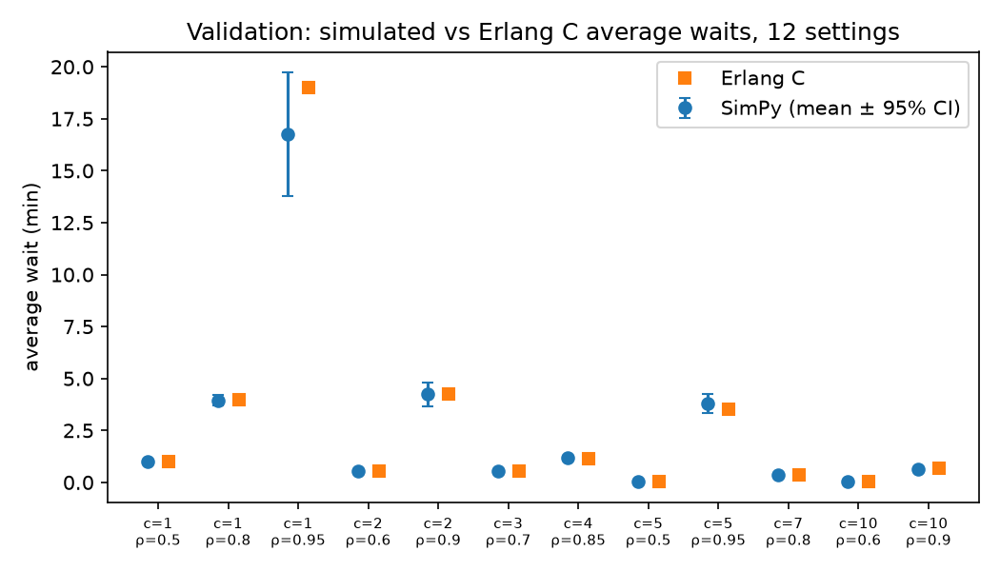
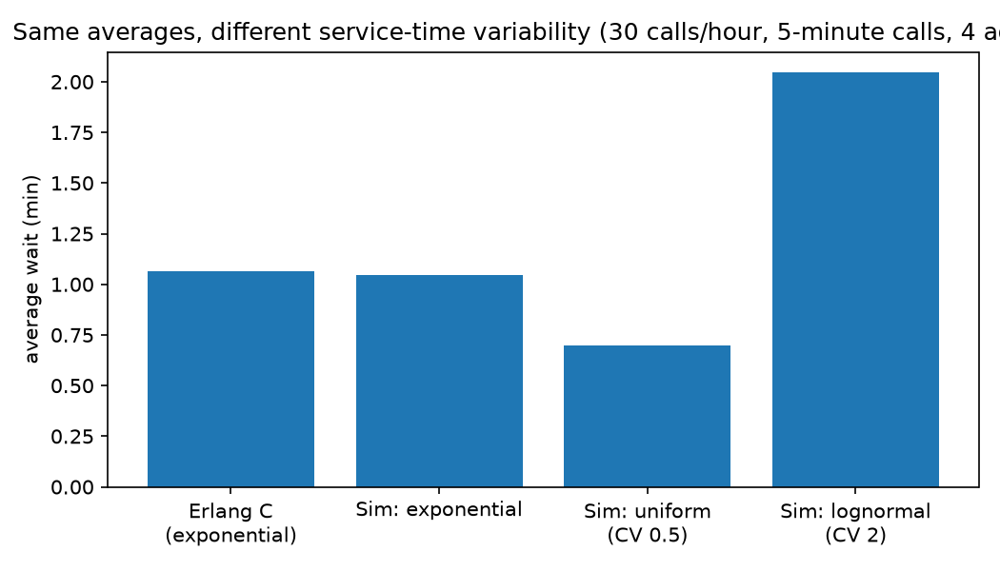
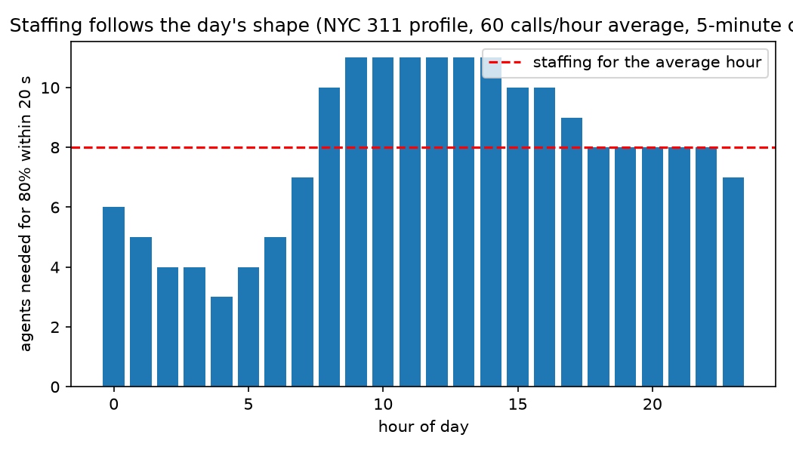
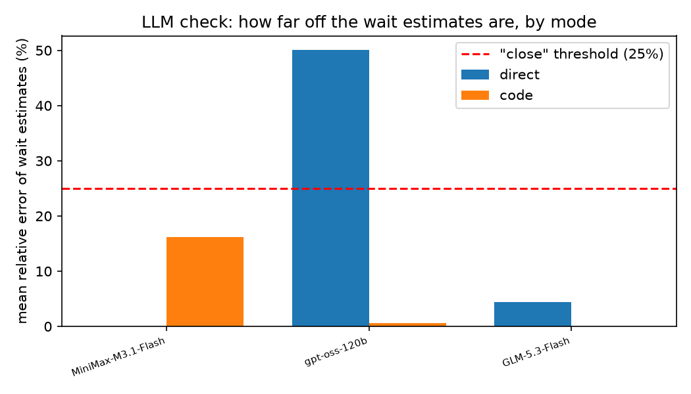
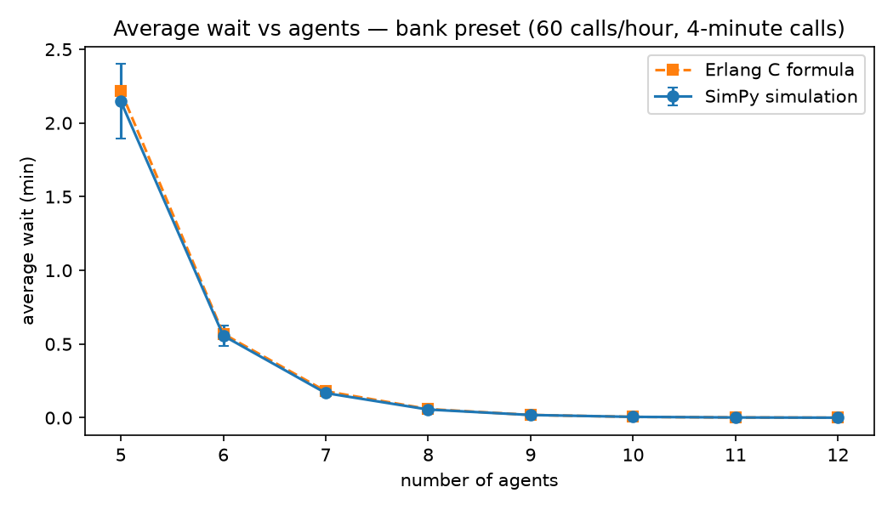

# Results — queue-simulator (P11)

All numbers below are regenerated by `python -m queuesim.analyze` from the saved outputs in `outputs/`. The plan is in `PLAN.md`; choices and deviations are in `DECISIONS.md`.

## 1. Validation against Erlang C

12 M/M/c settings (c from 1 to 10, utilisation 0.5–0.95), 16 independent replications each. The Erlang C value falls inside the simulation's 95% confidence interval in 12 of 12 settings; the largest relative difference is -11.8% (c=1, ρ=0.95). Little's law, measured from each run's own counters, deviates from L = λW by at most 0.12% across the 12 settings.

| servers | ρ | Erlang C wait (min) | simulated wait (min) | ±95% CI | rel. diff | P(wait>20 s): formula | simulated |
|---|---|---|---|---|---|---|---|
| 1 | 0.5 | 1.00 | 1.01 | 0.03 | +1.1% | 42.3% | 42.7% |
| 1 | 0.8 | 4.00 | 3.95 | 0.27 | -1.2% | 74.8% | 74.8% |
| 1 | 0.95 | 19.00 | 16.76 | 2.98 | -11.8% | 93.4% | 93.1% |
| 2 | 0.6 | 0.56 | 0.55 | 0.03 | -2.1% | 34.5% | 34.4% |
| 2 | 0.9 | 4.26 | 4.24 | 0.56 | -0.5% | 79.8% | 79.3% |
| 3 | 0.7 | 0.55 | 0.56 | 0.03 | +1.5% | 36.5% | 36.6% |
| 4 | 0.85 | 1.15 | 1.17 | 0.12 | +1.8% | 56.4% | 56.4% |
| 5 | 0.5 | 0.05 | 0.05 | 0.00 | -1.2% | 5.7% | 5.6% |
| 5 | 0.95 | 3.51 | 3.81 | 0.46 | +8.5% | 80.8% | 82.1% |
| 7 | 0.8 | 0.35 | 0.34 | 0.01 | -1.0% | 30.5% | 30.2% |
| 10 | 0.6 | 0.03 | 0.03 | 0.00 | +0.6% | 2.7% | 2.7% |
| 10 | 0.9 | 0.67 | 0.64 | 0.05 | -3.8% | 47.9% | 47.2% |

## 2. Where the formula stops working

**Service-time variability.** Same arrival rate, same average call length, 4 agents: Erlang C (which assumes exponential calls) says 1.07 min. The simulation agrees for exponential calls (1.04 min), gives 0.70 min for steadier uniform calls (CV 0.5), and 2.05 min for very variable lognormal calls (CV 2). The average call length is not enough; the spread changes the answer.

**Abandonment.** At ρ = 0.95 with 5 agents, Erlang C (nobody hangs up) predicts 26.33 min. With callers hanging up after 10 minutes on average, the simulated wait of served callers is 1.32 min and 14.7% of callers give up; with 4-minute patience the wait is 0.58 min and 18.5% give up. The formula cannot see any of this.

**A day with rush hours.** Staffing a centre with 8 agents (the 80%-in-20-seconds answer for the *average* hour of the NYC-311-shaped day): the formula at the average rate predicts 0.28 min waits, a flat simulated day gives 0.28 min, and the shaped day gives 2.92 min with 41.4% of callers waiting over 20 seconds. Averaging the day first and applying the formula second understates the waits, because the rush hours dominate.

## 3. Arrival data: the shape of a service day

NYC 311 service requests, January 2024 (9,264 requests/day): the busiest hour (9:00) averages 601 requests/hour, the quietest (4:00) 109 — a 5.5× swing inside one day. Scaled to a centre averaging 60 calls/hour with 5-minute calls, the 80%-in-20-seconds staffing ranges from 3 agents overnight to 11 mid-morning; staffing flat for the average hour (8) is wrong in both directions. (Only the shape is borrowed; 311 requests are not calls to one centre. See `DATA_SOURCES.md`.)

## 4. The LLM check: can a model do this?

15 scenarios × 3 modes. Ground truth: Erlang C for the 10 formula/trap scenarios; 200 SimPy replications for the 5 beyond-formula ones. A numeric answer counts as *close* at ≤ 25% relative error on the wait and ≤ 10 points on the percentage. The hand simulation is scored per customer (≤ 0.11 min error = tracked).

The two error averages rest only on answers actually given: a wait error exists only where the model printed a number, and a hand MAE only over the customers whose waits could be checked. The 'answers counted / asked' column gives that basis for each row (wait answers behind the average, out of the wait questions in the runs that returned output; for hand rows, checked customer waits out of the served customers), so a small average on few answers does not read as a good average.

| model | mode | scenarios close | code failed | answers counted / asked | mean wait rel. err (answered items only) | mean pct err (pts) | hand: customers tracked | hand MAE (min, answered items only) |
|---|---|---|---|---|---|---|---|---|
| MiniMaxAI/MiniMax-M3.1-Flash | direct | 9/15 | 0 | 10/16 | 0% | 2.1 | – | – |
| MiniMaxAI/MiniMax-M3.1-Flash | code | 7/15 | 0 | 8/16 | 16% | 6.4 | – | – |
| MiniMaxAI/MiniMax-M3.1-Flash | hand | – | 0 | 173/300 | – | – | 58% | 0.00 |
| openai/gpt-oss-120b | direct | 9/15 | 0 | 14/16 | 50% | 6.6 | – | – |
| openai/gpt-oss-120b | code | 14/15 | 1 | 14/15 | 1% | 0.1 | – | – |
| openai/gpt-oss-120b | hand | – | 0 | 156/300 | – | – | 50% | 0.03 |
| zai-org/GLM-5.3-Flash | direct | 9/15 | 0 | 9/16 | 4% | 2.4 | – | – |
| zai-org/GLM-5.3-Flash | code | 2/15 | 1 | 2/15 | 0% | 0.0 | – | – |
| zai-org/GLM-5.3-Flash | hand | – | 0 | 140/300 | – | – | 45% | 0.04 |

Ground truth for each scenario, the numbers the answers were scored against (the full per-run scores are in `outputs/llm_scores.json`):

| scenario | kind | truth: wait (min) | truth: % over 20 s | note |
|---|---|---|---|---|
| F1 Small support desk | formula | 1.07 | 28.9% |  |
| F2 Bank call centre | formula | 0.57 | 24.1% |  |
| F3 Clinic phone line | formula | 2.25 | 28.7% |  |
| F4 Busy help line | formula | 0.54 | 28.6% |  |
| F5 Loaded service desk | formula | 3.53 | 55.6% |  |
| T1 Per-minute arrivals, seconds for service | trap | 0.82 | 34.6% |  |
| T2 One call every 30 seconds | trap | 0.54 | 28.6% |  |
| T3 Nearly saturated centre | trap | 16.51 | 81.2% |  |
| T4 Utilisation given, arrival rate hidden | trap | 9.15 | 74.2% |  |
| T5 The 20-second target | trap | 0.61 | 27.1% |  |
| B1 Very variable call lengths | beyond | 2.00 | 29.8% |  |
| B2 Callers hang up | beyond | 1.29 | 42.3% |  |
| B3 Rush hours | beyond | 11.25 | 56.8% |  |
| B4 More calls than the team can handle | beyond | 49.92 | 95.5% | no steady state exists (ρ > 1) |
| B5 Priority customers | beyond | priority 0.37 / regular 1.13 | – | two customer classes with separate waits (200 replications); no single pooled wait or percentage |

## 5. Playground data

The wait-vs-servers curves in `docs/` are precomputed from the same simulator (20 replications per point) for three presets. The browser's JavaScript simulator and Erlang C implementation are checked against the Python ones on fixed cases; see `docs/data/check_cases.json`.

## 6. Spend

- pilot: 90 priced calls, $0.1444 (by model: MiniMaxAI/MiniMax-M3.1-Flash $0.0281, Qwen/Qwen3.5-9B $0.0151, deepseek-ai/DeepSeek-V4.1-Flash $0.0567, openai/gpt-oss-120b $0.0196, together/Tev1-4B-experimental $0.0002, zai-org/GLM-5.3-Flash $0.0248)
- main run: 135 priced calls, $0.2342 (by model: MiniMaxAI/MiniMax-M3.1-Flash $0.0873, openai/gpt-oss-120b $0.0699, zai-org/GLM-5.3-Flash $0.0770)
- **Total model spend: $0.3786** of the $5.00 project cap.
